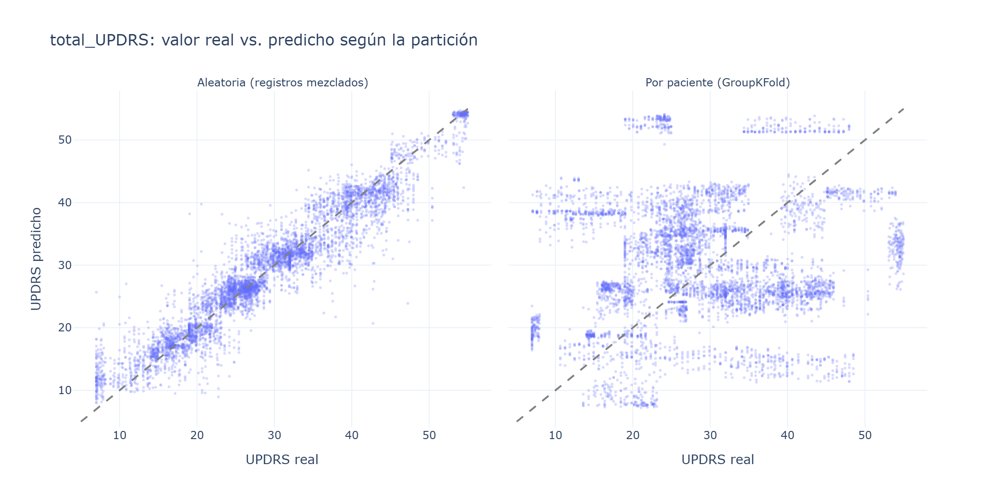

# Predictores longitudinales en Parkinson con Machine Learning y Deep Learning

Proyecto de análisis de datos clínicos **longitudinales** (mediciones repetidas por paciente) para identificar predictores de la progresión de la enfermedad de Parkinson. Compara modelos estadísticos, machine learning y deep learning, con foco en **validar como en el uso real**: con pacientes que el modelo nunca vio.

## Pregunta

¿Las medidas de voz registradas en el hogar permiten estimar la gravedad del Parkinson (escala UPDRS) y seguir su evolución en cada paciente?

## Hallazgos principales

| # | Hallazgo | Notebook |
|---|---|---|
| 1 | **El 93% de la variación en la gravedad es entre pacientes**; dentro de cada paciente cambia poco en 6 meses (+0,57 puntos de UPDRS por mes en promedio). | 01 · 03 |
| 2 | **Una partición aleatoria de train/test infla las métricas de forma drástica:** el mismo Random Forest pasa de R² = 0,91 a R² = −0,64 cuando se evalúa en pacientes nuevos. Con la partición aleatoria el modelo "memoriza" pacientes a partir de la edad, el sexo y medidas de voz estables. | 02 |
| 3 | **Para pacientes nuevos, ningún modelo supera a predecir el promedio** (MAE ≈ 8,9 puntos). Conocer la línea de base del propio paciente reduce el error a ≈ 3,4 puntos (−62%). | 02 |
| 4 | **Ninguna medida de voz funciona como predictor longitudinal:** en el modelo mixto con descomposición entre / dentro del paciente, ningún efecto dentro del paciente resulta significativo, y tampoco entre pacientes. La conclusión se confirmó revisando los supuestos del modelo y con métodos que no dependen de ellos. | 03 |
| 5 | **El deep learning no supera a una regla simple:** pronosticando a 4 semanas, la extrapolación lineal (MAE 0,31) supera a la LSTM (1,68) y a Ridge (0,62). Es coherente con la UPDRS interpolada del dataset y con la muestra chica (42 pacientes). | 03 |



## Qué significa esto

- **Para evaluar cualquier modelo clínico, validar por paciente.** Con una partición aleatoria, este proyecto habría reportado un modelo excelente (R² 0,91) que en realidad no generaliza a pacientes nuevos.
- **Para un sistema de monitoreo remoto, empezar por la línea de base de cada paciente.** Sin ella, la voz no estima la gravedad mejor que el promedio; con ella, el error baja un 62%.
- **Antes de usar deep learning, comparar contra reglas simples.** Con 42 pacientes, una extrapolación lineal pronostica mejor que la LSTM.

## Notebooks

| Notebook | Contenido |
|---|---|
| [01 · Exploración longitudinal](notebooks/01_exploracion_longitudinal.ipynb) | Diseño longitudinal, trayectorias por paciente, varianza entre / dentro de pacientes, correlación global vs. dentro del paciente, redundancia entre variables |
| [02 · Modelado con validación por paciente](notebooks/02_modelado_validacion_por_paciente.ipynb) | `KFold` vs. `GroupKFold`, importancia por permutación, comparación contra baselines, predicción del cambio respecto de la línea de base |
| [03 · Modelos mixtos y deep learning](notebooks/03_modelos_mixtos_y_deep_learning.ipynb) | Modelo mixto (intercepto y pendiente aleatorios) con descomposición entre / dentro, diagnóstico de supuestos y chequeos de robustez, pronóstico a 4 semanas con LSTM (PyTorch) vs. baselines |

Cada notebook abre con un **resumen ejecutivo** que se calcula automáticamente a partir de los datos.

> GitHub no muestra los gráficos interactivos de Plotly. Están guardados como PNG y como HTML interactivo en [`reports/`](reports/).

## Métodos

- **Validación:** `GroupKFold` por paciente; comparación sistemática contra baselines (promedio, persistencia, tendencia lineal).
- **Estadística longitudinal:** proporción de varianza entre pacientes (aprox. ICC), modelos lineales mixtos (`statsmodels`) con descomposición entre / dentro (Mundlak).
- **Diagnóstico del modelo:** convergencia, QQ-plots de residuos y efectos aleatorios, varianza constante y autocorrelación de residuos; las conclusiones se repiten con métodos robustos a esos supuestos (pendiente por paciente + test t, regresión a nivel paciente).
- **Machine Learning:** Ridge, Random Forest, XGBoost; importancia por permutación.
- **Deep Learning:** LSTM sobre secuencias semanales (PyTorch), con estandarización calculada solo en entrenamiento.
- **Visualización:** Plotly.

## Datos

**Parkinson's Telemonitoring (UCI)**: 42 pacientes con Parkinson temprano, ~140 grabaciones de voz por paciente durante 6 meses, con la gravedad medida por la escala UPDRS (motora y total).
Tsanas, A. & Little, M. (2009). UCI Machine Learning Repository. https://doi.org/10.24432/C5ZS3N. Licencia CC BY 4.0.

Los datos no se versionan: se descargan automáticamente con `src/data.py`.

## Limitaciones

- En el estudio original, la UPDRS fue evaluada clínicamente al inicio, a los 3 y a los 6 meses; los valores intermedios están interpolados.
- 42 pacientes en etapa temprana: muestra chica para generalizar y para entrenar redes neuronales.
- Por la interpolación, los residuos del modelo mixto están muy autocorrelacionados semana a semana (r ≈ 0,93). Por eso las conclusiones principales se verificaron con métodos que no dependen de ese supuesto.
- El dataset no incluye variables autonómicas (por ejemplo, termorregulación). Una extensión natural es aplicar este enfoque a cohortes como PPMI, con escalas como SCOPA-AUT.

## Cómo reproducirlo

```bash
git clone https://github.com/CaroBailon/parkinson-longitudinal-ml.git
cd parkinson-longitudinal-ml
python -m venv .venv
source .venv/Scripts/activate      # Windows (Git Bash). En Linux/Mac: source .venv/bin/activate
pip install -r requirements.txt   # en Linux, para evitar descargar CUDA: pip install torch --index-url https://download.pytorch.org/whl/cpu antes
python src/data.py                  # descarga los datos
jupyter notebook                    # ejecutar los notebooks en orden: 01 → 02 → 03
```

## Estructura

```
├── data/          # datos (no versionados)
├── notebooks/     # análisis paso a paso (01 → 03)
├── reports/       # gráficos en PNG y HTML interactivo
└── src/           # funciones reutilizables
    ├── data.py          # descarga y carga
    ├── analysis.py      # análisis exploratorio longitudinal
    ├── modeling.py      # experimentos de validación (notebook 02)
    ├── longitudinal.py  # modelos mixtos
    ├── deep.py          # ventanas temporales, baselines y LSTM
    ├── resumen03.py     # resumen ejecutivo del notebook 03
    └── viz.py           # gráficos y guardado
```

## Licencia

El código se distribuye bajo licencia [MIT](LICENSE). Los datos son de UCI, con licencia CC BY 4.0.

## Autora

**Carolina Bailon Trujillo** · Estudiante de Ciencia de Datos en Organizaciones (UNLP)
[LinkedIn](https://www.linkedin.com/in/carolinabailontrujillo/) · [GitHub](https://github.com/CaroBailon)
